# AVAWizardry: the Proving Grounds of the Mad Archmage

[](https://github.com/Harlock123/AVAWizardry/actions/workflows/build.yml)

**AVAWizardry** is a party-based dungeon crawl in the style of *Wizardry: Proving Grounds of the
Mad Overlord* (Sir-Tech, 1981), written in C# with .NET 10 and Avalonia 12. It runs on Windows,
macOS and Linux, on Intel and ARM.

The mad archmage Morthrain has stolen the Amulet of Thal and fled to the bottom of a ten-level
maze beneath the Overlord's castle. Make a party of up to six adventurers, outfit them, and send
them down through the dark to bring it back.

- **The 1981 rules:** five races, eight classes with the original requirements and alignments
  (fighter, mage, priest, thief, bishop, samurai, lord, ninja), bonus points, the experience
  table, levels gained at the inn, aging, class changes, and the front rank of three.
- **47 spells in seven levels** for mages and priests, with casts per level restored by rest.
- **Ten 20×20 levels**, the same in every game: doors, secret doors, darkness, spinners,
  teleporters, pits, chutes, dead-magic squares, rooms with guarded chests, two lifts, the Iron
  Warden on level 4, and Morthrain's sanctum on level 10.
- **50 monsters** in up to four groups a fight, unidentified until you know what they are, with
  breath weapons, spells, poison, paralysis, stoning, energy drain and mortal blows.
- **76 items**, including cursed ones that won't come off, and unidentified loot for the
  trading post or a bishop to name. Chests carry nine kinds of trap, to inspect, name and disarm.
- **The castle:** the tavern, the inn (from the stables to the royal suite), the trading post, the
  temple (where raising the dead can leave ashes, and raising ashes can lose a character for good),
  and the training grounds.
- **Wireframe first-person view** with vector line art for every monster family and castle
  building, an optional automap, synthesised sound effects and music, and in-game help.
- **A ready-made party** for a quick start, or make your own. Rescue patrols bring a fallen party
  home, or turn them off for the classic rule: the bodies stay where they fell until another of
  your parties recovers them.

The maze, story, names, spell names, monsters, items, pictures, music and code are this game's own.
Only the rules follow the original. See [About and licence](#about-and-licence).

## Screenshots

| The maze, with light and the automap | A fight | Morthrain |
|---|---|---|
| 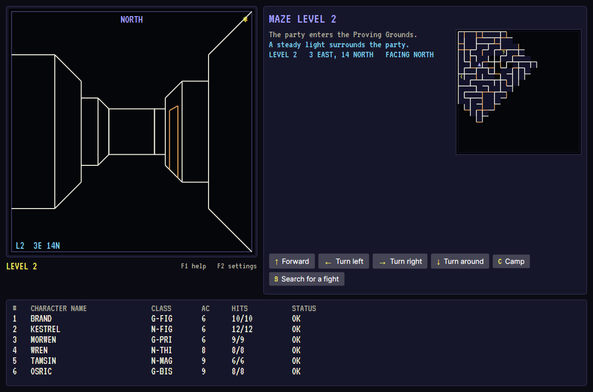 | 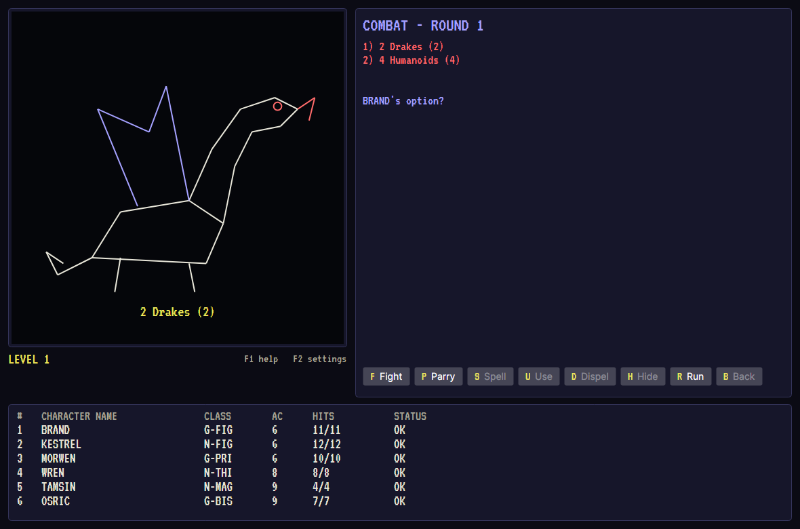 | 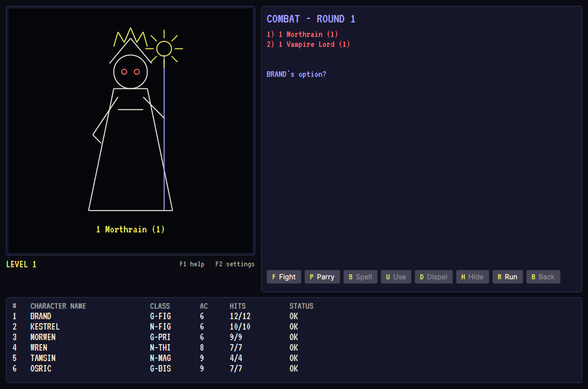 |

| The castle | Making a character | A character sheet |
|---|---|---|
| 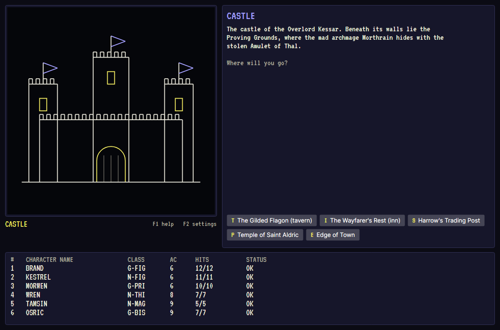 | 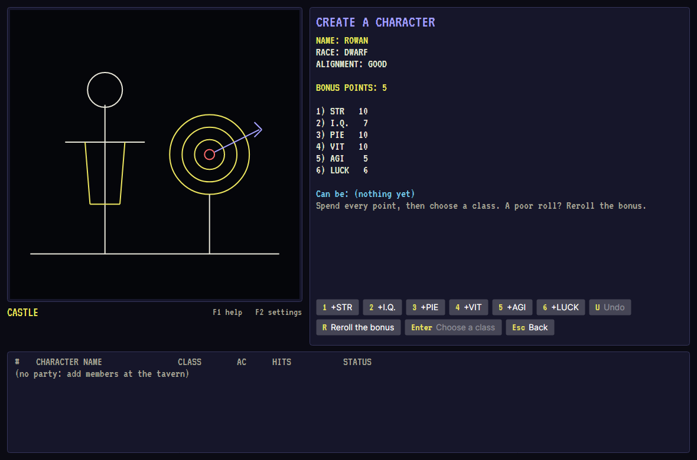 | 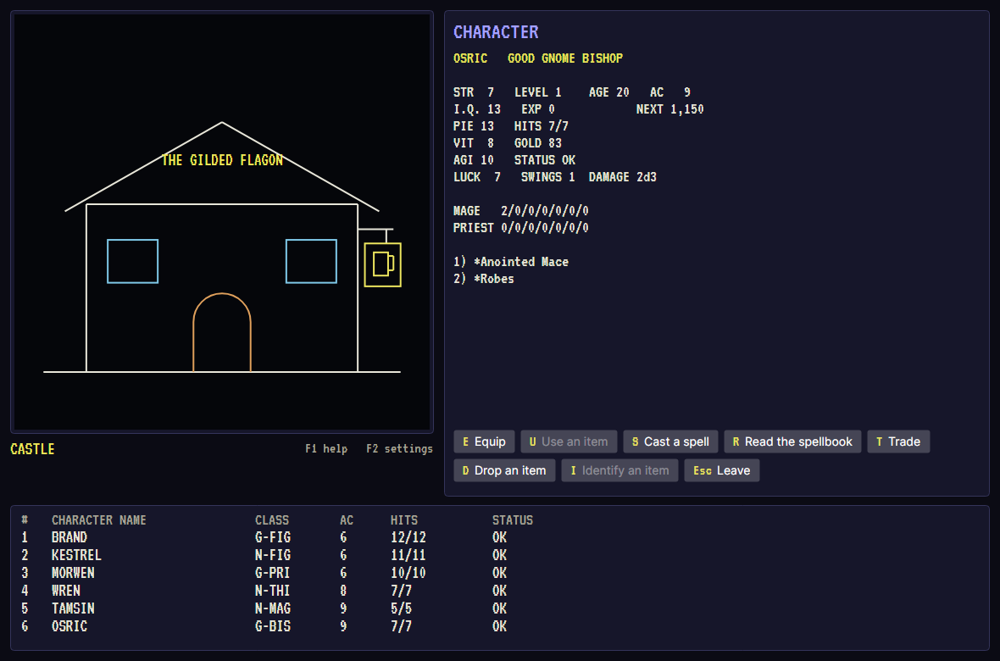 |

| The trading post | A chest | Victory |
|---|---|---|
| 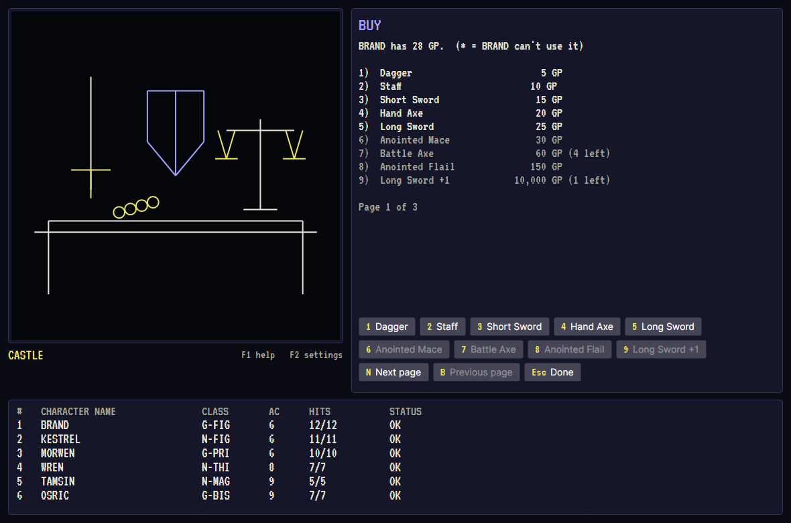 | 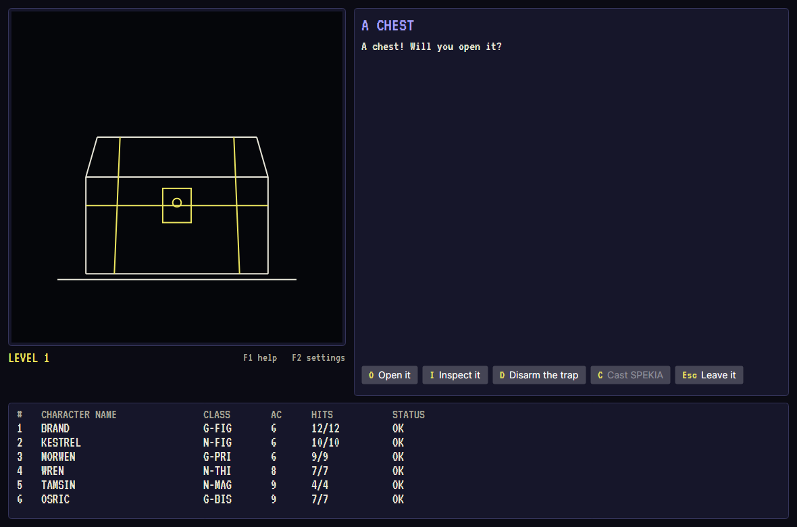 | 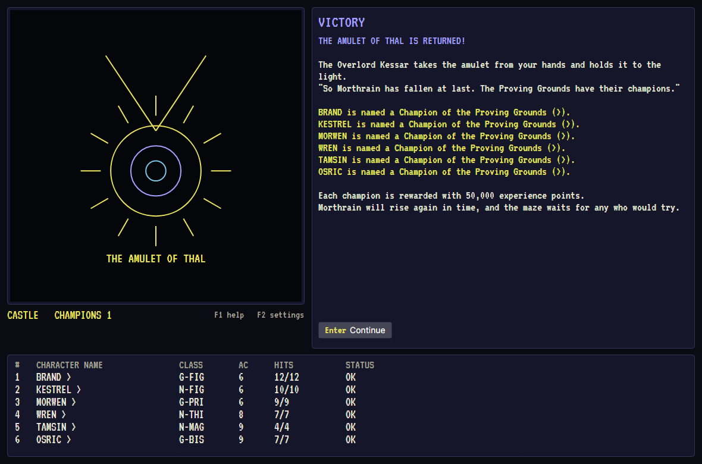 |

| The title | The maze, unlit | Help |
|---|---|---|
| 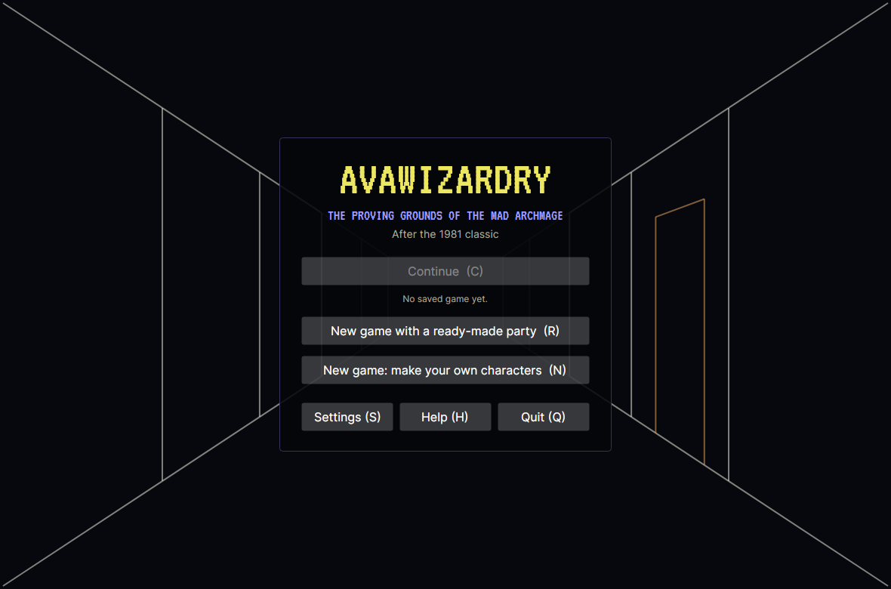 | 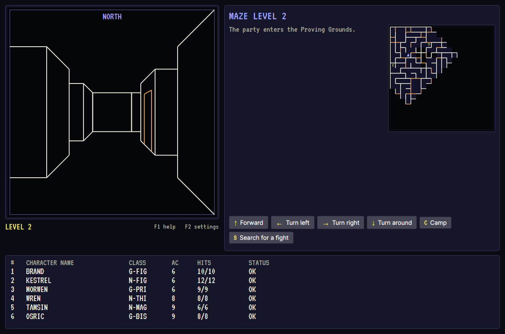 | 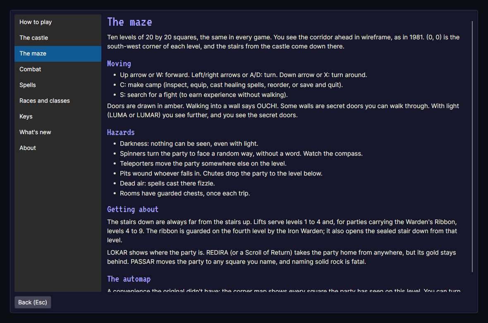 |

The screenshots are made by the UI tests, which drive the real window headlessly (see
[Build, run, test](#build-run-test)).

## Download

Ready-to-run builds are on the [Releases page](https://github.com/Harlock123/AVAWizardry/releases/tag/latest).
**Latest build (main)** is rebuilt on every push to `main`. Each one is a single self-contained
program, so there's no .NET to install. Download the archive for your platform, extract it and run
`AVAWizardry` (`AVAWizardry.exe` on Windows).

| Platform | Archive |
|---|---|
| Windows | `AVAWizardry-win-x64.zip`, `AVAWizardry-win-x86.zip`, `AVAWizardry-win-arm64.zip` |
| macOS | `AVAWizardry-osx-arm64.tar.gz` (Apple silicon), `AVAWizardry-osx-x64.tar.gz` (Intel) |
| Linux | `AVAWizardry-linux-x64.tar.gz`, `AVAWizardry-linux-arm64.tar.gz`, `AVAWizardry-linux-arm.tar.gz` |

The macOS build isn't signed, so the first launch is blocked: run
`xattr -d com.apple.quarantine AVAWizardry` once, or allow it under System Settings → Privacy & Security.

## How to play

Choose **New game with a ready-made party** for six adventurers (two fighters, a priest, a thief,
a mage and a bishop) already armed and gathered. Or choose **make your own**, go to *Edge of Town >
Training Grounds* to create characters, and add them at the tavern.

Then *Edge of Town > Enter the maze*. Walk with the arrow keys (or W/A/D, X to turn around). Fight,
gather gold and loot, and come back to the inn to rest: levels are only gained there. When the
party is strong enough, find the Iron Warden on the fourth level. Its ribbon opens the way down and
works the lift to the deep levels. At the bottom waits Morthrain.

Every choice on screen shows its key. F1 opens the help, which covers the castle, the maze,
combat, races and classes, every spell, and the keys. F2 opens the settings.

## Build, run, test

Requires the .NET SDK 10.0.400 or a newer 10.0 feature band (`global.json` pins it with
`latestFeature` roll-forward).

```sh
dotnet build AVAWizardry.slnx
dotnet run --project src/Wizardry.Desktop          # add -- --no-audio for silence
dotnet test AVAWizardry.slnx
```

The tests include a bot that plays the whole game through its menus, pressing keys as a player
would. It creates a party, shops, rests, explores, fights, opens chests, beats the Warden, rides
the lifts and kills Morthrain, on two different seeds. The UI tests drive the real window
headlessly. To regenerate the screenshots:

```sh
WIZ_SCREENSHOT_DIR=$PWD/docs/screenshots dotnet test tests/Wizardry.Desktop.Tests
```

The sound effects and two of the tunes are synthesised by `tools/retro_audio.py` (standard-library
Python; ffmpeg encodes the Ogg files).

## Publish

```sh
dotnet publish src/Wizardry.Desktop -c Release -r linux-x64 --self-contained true \
  -p:PublishSingleFile=true -p:IncludeNativeLibrariesForSelfExtract=true \
  -p:IncludeAllContentForSelfExtract=true -o out/linux-x64
```

GitHub Actions does this for all eight platforms on every push (`.github/workflows/build.yml`).

## Where things are stored

- Saves: `world.json` (and the previous save, `world.bak.json`) under the local application data
  folder: `%LOCALAPPDATA%\AVAWizardry\saves`, `~/.local/share/AVAWizardry/saves`, or
  `~/Library/Application Support/AVAWizardry/saves`.
- Settings: `settings.json` under the application data folder (`%APPDATA%\AVAWizardry`,
  `~/.config/AVAWizardry`, or `~/Library/Application Support/AVAWizardry`).

## Repository layout

| Project | What it is |
|---|---|
| `src/Wizardry.Core` | The game, with no UI dependency: rules, races and classes, spells, items, monsters, the maze builder, combat, the castle, and every screen as a menu state machine. |
| `src/Wizardry.Audio` | OpenAL sound effects, music and ambience, from the author's AVABand. |
| `src/Wizardry.Infrastructure` | Saves, settings and per-user folders. |
| `src/Wizardry.Desktop` | The Avalonia app: the wireframe maze, the line art, the views. |
| `tests/Wizardry.Core.Tests` | Rules, maze, combat, screens, saves, and the bot playthrough. |
| `tests/Wizardry.Desktop.Tests` | Headless UI tests and screenshots. |
| `tools/retro_audio.py` | Synthesises the sound effects and themes. |

## About and licence

AVAWizardry's own code, tools and documentation are under the [MIT License](LICENSE)
(© 2026 Lonnie Watson). Bundled third-party components and assets keep their own licences:
OpenAL Soft is LGPL-2.0-or-later, the Dubtrain effects are CC BY 4.0, the music and ambience are
CC0, and the VT323 font is OFL 1.1. See [THIRD_PARTY_NOTICES.md](THIRD_PARTY_NOTICES.md).

*Wizardry: Proving Grounds of the Mad Overlord* © 1981 Sir-Tech Software. The Wizardry name is a
trademark of its current owner. AVAWizardry is an independent, unofficial game, written from the
original's published rules. It contains no original program code, data, maps, artwork or text,
and is not affiliated with or endorsed by any rights holder.
